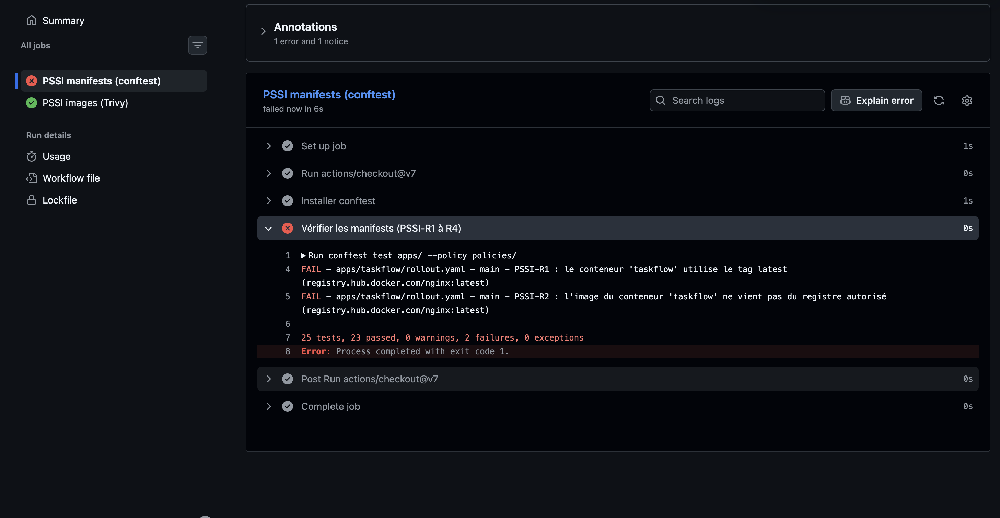

# taskflow-gitops — dépôt GitOps du cours CI/CD M2

Ce dépôt décrit **l'état voulu** de l'application TaskFlow dans Kubernetes.
Argo CD le surveille et aligne le cluster dessus : pour changer la production,
on ne tape pas de commande, on fait une **Pull Request**.

## Installation (à faire chez vous, avant le cours)

Prérequis : Docker Desktop démarré, 8 Go de RAM, 10 Go de disque libre.
Sous Windows : WSL2 (Ubuntu) + intégration WSL de Docker Desktop, et toutes les commandes dans WSL.

```bash
git clone https://github.com/9m7fjfpv9k-cyber/taskflow-gitops.git
cd taskflow-gitops
./scripts/install.sh
```

Le script crée un cluster local `kind`, installe Argo CD et Argo Rollouts,
puis télécharge les images des labs. Comptez 5 à 15 minutes.
Il peut être relancé sans risque.

## Structure

| Chemin | Rôle |
| --- | --- |
| `apps/taskflow/` | Les manifests surveillés par Argo CD |
| `argocd/application.yaml` | Déclare l'application dans Argo CD |
| `exemples/bluegreen/` | Manifests pour le déploiement Blue-Green |
| `exemples/canary/` | Manifests pour le déploiement Canary |
| `exemples/robustesse/` | Canary avec test de charge k6 automatique, modèle de postmortem |
| `exemples/ci/` | Pipelines de la mini-PSSI (GitHub Actions et GitLab CI) |
| `policies/` | Mini-PSSI et règles Rego vérifiées par conftest |
| `scripts/install.sh` | Installation de l'environnement |
| `scripts/argocd-ui.sh` | Ouvre l'interface d'Argo CD |
| `scripts/observe.sh` | Montre quelle version répond, et avec quel code HTTP |
| `scripts/charge.sh` | Lance à la main le test de charge k6 contre un service |

## Images disponibles

`ghcr.io/9m7fjfpv9k-cyber/taskflow` en versions `1.0.0`, `1.1.0`, `2.0.0`, `2.1.0` et `2.2.0`.

## Équipe

<!-- Noms du binôme -->
- Matteo MENCUCCINI
- Sabri ABID

## Livrable

### Argo CD : déploiements par Pull Request et `git revert`


Tous les déploiements viennent d'un pull, car c'est Argo CD qui va regarder la source de vérité (le repo GitHub) et ordonner le déploiement/la modification des ressources sur le cluster Kubernetes.

Le `git revert` sert à annuler les changements d'un commit existant, et donc à revenir en arrière. Cela permet à Argo CD d'annuler des changements faits (venant du repo ayant été modifié), car le nouveau commit de revert ramène le code à l'état d'avant (du point de vue du code, on est revenu en arrière ; du point de vue de l'historique, on a un commit en plus). Argo CD suit simplement la tête de la branche et aligne le cluster dessus.

### Argo Rollouts : Blue-Green

Comme on peut le voir, après avoir lancé la PR remplaçant le Deployment par un Rollout Blue-Green, et avoir lancé la deuxième PR pour changer la version de l'application, nous avons maintenant 4 pods dans l'ancienne version et 4 dans la nouvelle (chacune étant exposée via un service, comme précisé dans le YAML du Rollout : `taskflow` pour la version active, `taskflow-preview` pour la nouvelle).


Nous pouvons maintenant faire le promote du Rollout : le service actif `taskflow` bascule des pods blue (1.0.0) vers les pods green (1.1.0), qui deviennent la version de référence après le promote.

État avant promote :

```console
$ ./scripts/observe.sh
     40 version=1.0.0 http=200

$ kubectl get pods -n taskflow
NAME                        READY   STATUS    RESTARTS   AGE
taskflow-5769dcb86c-8nxzg   1/1     Running   0          46m
taskflow-5769dcb86c-dfzvd   1/1     Running   0          46m
taskflow-5769dcb86c-sj4nq   1/1     Running   0          46m
taskflow-5769dcb86c-wt95t   1/1     Running   0          46m
taskflow-78cdc8775b-97kbw   1/1     Running   0          11m
taskflow-78cdc8775b-dkbj6   1/1     Running   0          11m
taskflow-78cdc8775b-qbprt   1/1     Running   0          11m
taskflow-78cdc8775b-z6tv7   1/1     Running   0          11m
```

Résultat sur le service preview :

```console
$ ./scripts/observe.sh taskflow-preview
     40 version=1.1.0 http=200
```

Comme nous pouvons le voir, le rollout est instantané, car la nouvelle version a entièrement été poussée sur le cluster avant que l'ancienne version ne soit supprimée (principe du Blue-Green). La bascule se résume à un changement de selector sur le service, et les anciens pods sont supprimés 30 s plus tard (`scaleDownDelaySeconds: 30`).


État après promote :

```console
$ ./scripts/observe.sh
     40 version=1.1.0 http=200
```

### Argo Rollouts : Canary

Pour le Canary, on peut voir qu'après la synchronisation par Argo CD, on bloque à 25 % de pods en nouvelle version (soit 1 pod sur 4 dans notre cas), car l'étape `pause: {}` n'a pas de durée et attend un promote manuel.


Avec le script, on peut voir que la charge bascule bien en fonction de la proportion de pods en 1.0.0 et en 2.0.0 (la répartition est approximative, car les requêtes sont distribuées aléatoirement entre les pods) :

```console
$ ./scripts/observe.sh
     33 version=1.0.0 http=200
      7 version=2.0.0 http=200
```

En lançant la suite (Promote), nous allons d'abord passer à 50 % avec une pause de 60 secondes, puis à 75 % avec une pause de 30 secondes, et enfin à 100 % en nouvelle version. Tout cela peut être interrompu avec Abort pour revenir en 1.0.0, ou même PromoteFull pour tout passer en 2.0.0 d'un coup. Dans notre cas, nous allons laisser le cheminement se faire et prendre des captures des différents états.

#### 50 %


```console
$ ./scripts/observe.sh
     18 version=1.0.0 http=200
     22 version=2.0.0 http=200
```

#### 75 %


```console
$ ./scripts/observe.sh
      6 version=1.0.0 http=200
     34 version=2.0.0 http=200
```

#### 100 %


```console
$ ./scripts/observe.sh
     40 version=2.0.0 http=200
```

### Argo Rollouts : Abort d'un Canary

On va maintenant faire un Abort sur un Rollout Canary, avec le passage de la 2.0.0 à la 2.1.0.

Nous pouvons voir que le Rollout marche correctement (le pod en 2.1.0 est prêt, et le Rollout est en pause à 25 %) :


Regardons la charge de plus près :

```console
$ ./scripts/observe.sh
     29 version=2.0.0 http=200
      7 version=2.1.0 http=200
      4 version=aucune http=500
```

Une erreur est présente sur la nouvelle version : environ 1 requête sur 3 envoyée à la 2.1.0 renvoie une erreur 500 (4 sur 11). Nous allons donc faire un Abort du Rollout :


Argo CD affiche donc l'application en Degraded : le cluster tourne en 2.0.0, alors que le repo GitHub demande toujours la 2.1.0.


Pour corriger cela, nous allons faire un revert de la PR pour revenir à l'ancienne version.


Tout est bien resynchronisé : l'application repasse en Healthy, car la version demandée dans le repo (2.0.0) correspond de nouveau à celle qui tourne sur le cluster.

### Blue-Green ou Canary ?

En termes de risque et de coût, l'upgrade Blue-Green est toujours préférable si l'on a les moyens et les ressources sur le cluster, car il est plus sûr. Sinon, le Canary, quand il est possible, est plus simple à maintenir et permet d'avoir des retours utilisateurs pertinents (qui peuvent différer des retours techniques qu'on aurait avec le Blue-Green).

Deux nuances :

- **Coût du Blue-Green** : pendant le déploiement, les deux versions tournent en entier côte à côte, ce qui double les ressources nécessaires (8 pods au lieu de 4 dans notre cas).
- **Précision du Canary** : ici, la répartition du trafic se fait au nombre de pods (25 % = 1 pod sur 4), donc elle reste approximative. Pour piloter finement le pourcentage de trafic, indépendamment du nombre de pods, il faut ajouter un ingress ou un service mesh, ce qui complique la mise en place.

### Robustesse : analyse automatique du Canary

#### Mesure de référence

Avant de toucher au déploiement, nous mesurons la robustesse de la production actuelle (2.0.0) avec le même test de charge k6 que celui de l'analyse automatique : 5 utilisateurs virtuels pendant 30 s sur le service `taskflow`.

```console
$ ./scripts/charge.sh http://taskflow
  █ THRESHOLDS
    http_req_duration
    ✓ 'p(95)<250' p(95)=8.98ms
    http_req_failed
    ✓ 'rate<0.02' rate=0.00%
...
    http_reqs......................: 730    24.171578/s
Résultat : seuils respectés.
```

| Mesure en 2.0.0 | Valeur | Seuil de l'analyse |
| --- | --- | --- |
| Requêtes en erreur | 0 % (0 sur 730) | moins de 2 % |
| Temps de réponse p95 | 8,98 ms | moins de 250 ms |

La 2.0.0 respecte largement les deux seuils : c'est notre référence pour juger les prochaines versions.

#### Mise en place de l'analyse automatique

Nous étions déjà sur un Rollout Canary (il n'y avait donc plus de `deployment.yaml` à supprimer). Dans la PR `feat/analyse-auto`, nous avons remplacé ce Rollout par celui de `exemples/robustesse/` et ajouté les fichiers qui l'accompagnent dans `apps/taskflow/` :

| Fichier | Rôle |
| --- | --- |
| `rollout.yaml` | Canary qui lance l'analyse au palier de 25 % |
| `analysis-template.yaml` | AnalysisTemplate `robustesse-k6` : un Job k6, réussi = on continue, en échec = abort |
| `configmap-k6.yaml` | Le scénario k6 et ses seuils (moins de 2 % d'erreurs, p95 sous 250 ms) |
| `service-canary.yaml` | Service `taskflow-canary`, qui ne vise que les pods de la nouvelle version |

Le dossier `apps/taskflow/` contient donc un seul Rollout et aucun Deployment. L'image reste en 2.0.0 : la PR change la stratégie, pas la version, donc sa synchronisation ne déclenche pas de déploiement.

Le nouveau déroulé d'une mise à jour devient :

1. passage à 25 % (1 pod sur 4 en nouvelle version) ;
2. pause de 20 s, le temps que `taskflow-canary` vise le nouveau pod ;
3. test de charge k6 sur `taskflow-canary` seulement : s'il échoue, Argo Rollouts fait l'abort tout seul ;
4. sinon, 50 % puis 75 % (pauses de 30 s), puis 100 %.

Plus besoin de promote manuel : c'est le test de charge qui décide.

#### Vérifications

Les CRD d'Argo Rollouts nécessaires à l'analyse sont bien installées :

```console
$ kubectl get crd | grep -E 'rollouts|analysis'
analysisruns.argoproj.io               2026-10-14T07:10:45Z
analysistemplates.argoproj.io          2026-10-14T07:10:45Z
clusteranalysistemplates.argoproj.io   2026-10-14T07:10:46Z
rollouts.argoproj.io                   2026-10-14T07:10:46Z
```

Après la fusion de la PR (#20) et la synchronisation par Argo CD, on retrouve bien les nouvelles ressources dans le namespace : l'AnalysisTemplate `robustesse-k6`, la ConfigMap `k6-robustesse` (le scénario k6) et le service `taskflow-canary`.

```console
$ kubectl get analysistemplate,configmap,svc -n taskflow
NAME                                         AGE
analysistemplate.argoproj.io/robustesse-k6   17m

NAME                         DATA   AGE
configmap/k6-robustesse      1      17m
configmap/kube-root-ca.crt   1      25h

NAME                      TYPE        CLUSTER-IP      EXTERNAL-IP   PORT(S)   AGE
service/taskflow          ClusterIP   10.96.200.234   <none>        80/TCP    21h
service/taskflow-canary   ClusterIP   10.96.180.132   <none>        80/TCP    17m
```

### Robustesse : échec de la 2.1.0

On pousse maintenant la 2.1.0 par une PR, en suivant le Rollout avec `kubectl argo rollouts get rollout taskflow -n taskflow --watch`, mais sans toucher à rien : cette fois, c'est l'analyse qui doit décider.

> Remarque : notre première PR (#21) modifiait par erreur `exemples/canary/rollout.yaml` au lieu de `apps/taskflow/rollout.yaml`. Comme Argo CD ne surveille que `apps/taskflow/`, rien ne s'est passé sur le cluster. La bonne PR est la #22.

#### Déroulé

Comme on peut le voir dans les événements du Rollout (`kubectl describe rollout taskflow -n taskflow`), tout s'est enchaîné sans aucune intervention de notre part :

| Heure | Événement |
| --- | --- |
| 10:50:34 | Fusion de la PR #22 (image 2.1.0) |
| 10:50:41 | Argo CD synchronise : passage à 25 %, 1 pod en 2.1.0 et 3 pods en 2.0.0 |
| 10:50:43 | `taskflow-canary` bascule sur le pod 2.1.0 |
| 10:51:03 | Fin de la pause de 20 s : lancement de l'AnalysisRun, donc du Job k6 sur `taskflow-canary` |
| 10:51:40 | Seuils dépassés : AnalysisRun en échec, abort automatique, retour à 4 pods en 2.0.0 |

La 2.1.0 n'a donc été exposée qu'environ une minute, et seulement sur 1 pod sur 4 (environ 25 % du trafic).


État du Rollout après l'abort :

```console
$ kubectl argo rollouts get rollout taskflow -n taskflow
Status:          ✖ Degraded
Message:         RolloutAborted: Rollout aborted update to revision 7: Step-based analysis phase error/failed: Metric "test-de-charge-k6" assessed Failed due to failed (1) > failureLimit (0)
Strategy:        Canary
  Step:          0/7
  SetWeight:     0
  ActualWeight:  0
Images:          ghcr.io/9m7fjfpv9k-cyber/taskflow:2.0.0 (stable)

NAME                                                                 KIND         STATUS        INFO
⟳ taskflow                                                           Rollout      ✖ Degraded
├──# revision:7
│  ├──⧉ taskflow-df976ccb5                                           ReplicaSet   • ScaledDown  canary
│  └──α taskflow-df976ccb5-7-2                                       AnalysisRun  ✖ Failed      ✖ 1
│     └──⊞ 23fb84b8-9a34-48ce-809b-94cca62c024f.test-de-charge-k6.1  Job          ✖ Failed
├──# revision:6
│  └──⧉ taskflow-c6cf57bd6                                           ReplicaSet   ✔ Healthy     stable
│     ├──□ taskflow-c6cf57bd6-7ljwv                                  Pod          ✔ Running     ready:1/1
│     ├──□ taskflow-c6cf57bd6-65hxd                                  Pod          ✔ Running     ready:1/1
│     ├──□ taskflow-c6cf57bd6-g8t98                                  Pod          ✔ Running     ready:1/1
│     └──□ taskflow-c6cf57bd6-zpsg4                                  Pod          ✔ Running     ready:1/1
```

Comme pour l'abort manuel du Canary, le cluster tourne en 2.0.0 alors que le repo demande toujours la 2.1.0 : le Rollout et l'application Argo CD sont donc en Degraded jusqu'au revert de la PR.

#### Ce qu'a mesuré k6

Les logs du Job k6 montrent que les deux seuils sont dépassés :

```console
$ kubectl logs -n taskflow job/23fb84b8-9a34-48ce-809b-94cca62c024f.test-de-charge-k6.1
  █ THRESHOLDS
    http_req_duration
    ✗ 'p(95)<250' p(95)=313.27ms
    http_req_failed
    ✗ 'rate<0.02' rate=27.02%
...
    http_req_failed................: 27.02% 80 out of 296
    http_reqs......................: 296    9.720848/s
level=error msg="thresholds on metrics 'http_req_duration, http_req_failed' have been crossed"
```

| Mesure | 2.0.0 (référence) | 2.1.0 (canary) | Seuil |
| --- | --- | --- | --- |
| Requêtes en erreur | 0 % (0 sur 730) | 27 % (80 sur 296) | moins de 2 % |
| Temps de réponse p95 | 8,98 ms | 313 ms | moins de 250 ms |

#### Enquête : pourquoi Kubernetes n'a rien vu ?

Le pod 2.1.0 était pourtant `ready:1/1` pendant tout le test. Pour comprendre, nous avons lancé l'image 2.1.0 en local, hors du cluster :

```console
$ docker run -d --rm --name t210 -p 8001:8000 ghcr.io/9m7fjfpv9k-cyber/taskflow:2.1.0
$ curl -s localhost:8001/health
{"status":"ok","version":"2.1.0","pod":"866cbb37be90"}      # HTTP 200 en 4 ms
$ for i in $(seq 1 15); do curl -s -o /dev/null -w '%{http_code}\n' localhost:8001/tasks; done | sort | uniq -c
     10 200
      5 500                                                  # environ 300 ms par requête
```

`/health` répond parfaitement, alors que `/tasks` renvoie environ 1 requête sur 3 en erreur 500, avec 300 ms de latence. L'image est construite avec deux variables d'environnement qui injectent ces pannes :

```console
$ docker image inspect ghcr.io/9m7fjfpv9k-cyber/taskflow:2.1.0 --format '{{range .Config.Env}}{{println .}}{{end}}' | grep -E 'FAILURE|LATENCY'
FAILURE_RATE=0.3
LATENCY_MS=300
```

Et le middleware de l'application qui les applique épargne justement `/health` :

```python
@app.middleware("http")
async def inject_faults(request: Request, call_next):
    """Simule une version défaillante : /health reste sain, les utilisateurs souffrent."""
    if request.url.path != "/health":
        ...
```

Or nos deux probes (`readinessProbe` et `livenessProbe`) ne testent que `/health`. Pour Kubernetes, le pod était donc parfaitement sain, alors que les utilisateurs recevaient des erreurs. C'est exactement ce que l'analyse k6 rattrape : elle teste une vraie route (`/tasks`), sous charge, comme un utilisateur.

#### Revert de la PR 2.1.0

Pour remettre le repo en accord avec le cluster, nous avons fait un revert de la PR #22 (PR #23, fusionnée à 10:58:55).

Comme le cluster tournait déjà en 2.0.0, il n'y a eu aucun redéploiement : Argo Rollouts reconnaît que la version demandée est celle des pods stables déjà en place, et se contente de repasser en Healthy (événement `Rollback to stable ReplicaSets` à 10:59:26). Les pods 2.0.0 sont restés les mêmes, seule la révision change de numéro (la 6 devient la 8).

### Robustesse : succès de la 2.2.0

On refait exactement la même chose avec la 2.2.0 (PR #24), toujours avec le `--watch` et toujours sans toucher à rien.

#### Déroulé

Cette fois, l'analyse passe, et le Rollout va jusqu'au bout tout seul :

| Heure | Événement |
| --- | --- |
| 11:03:00 | Fusion de la PR #24 (image 2.2.0) |
| 11:03:23 | Argo CD synchronise : passage à 25 %, 1 pod en 2.2.0 et 3 pods en 2.0.0 |
| 11:03:49 | Fin de la pause de 20 s : lancement de l'AnalysisRun (Job k6 sur `taskflow-canary`) |
| 11:04:26 | Seuils respectés : AnalysisRun en succès, passage à 50 % |
| 11:05:01 | Passage à 75 % après la pause de 30 s |
| 11:05:37 | Passage à 100 % : 4 pods en 2.2.0, la 2.0.0 n'a plus de pods |

Le déploiement complet a pris moins de 3 minutes après la fusion de la PR, sans aucun promote manuel.


Résultat :


```console
$ kubectl argo rollouts get rollout taskflow -n taskflow
Status:          ✔ Healthy
Strategy:        Canary
  Step:          7/7
  SetWeight:     100
  ActualWeight:  100
Images:          ghcr.io/9m7fjfpv9k-cyber/taskflow:2.2.0 (stable)

NAME                                                                 KIND         STATUS        INFO
⟳ taskflow                                                           Rollout      ✔ Healthy
├──# revision:9
│  ├──⧉ taskflow-7ddd57d788                                          ReplicaSet   ✔ Healthy     stable
│  │  ├──□ taskflow-7ddd57d788-jk2fw                                 Pod          ✔ Running     ready:1/1
│  │  ├──□ taskflow-7ddd57d788-zkxqh                                 Pod          ✔ Running     ready:1/1
│  │  ├──□ taskflow-7ddd57d788-7974x                                 Pod          ✔ Running     ready:1/1
│  │  └──□ taskflow-7ddd57d788-m8xd9                                 Pod          ✔ Running     ready:1/1
│  └──α taskflow-7ddd57d788-9-2                                      AnalysisRun  ✔ Successful  ✔ 1
│     └──⊞ d1099338-c89e-4ba9-ba5f-91a9240a2d1c.test-de-charge-k6.1  Job          ✔ Successful
├──# revision:8
│  └──⧉ taskflow-c6cf57bd6                                           ReplicaSet   • ScaledDown
├──# revision:7
│  ├──⧉ taskflow-df976ccb5                                           ReplicaSet   • ScaledDown
│  └──α taskflow-df976ccb5-7-2                                       AnalysisRun  ✖ Failed      ✖ 1
│     └──⊞ 23fb84b8-9a34-48ce-809b-94cca62c024f.test-de-charge-k6.1  Job          ✖ Failed
```

On voit bien l'historique des deux tentatives : la révision 7 (2.1.0) avec son analyse en échec, et la révision 9 (2.2.0) avec son analyse réussie.

#### Ce qu'a mesuré k6

```console
$ kubectl logs -n taskflow job/d1099338-c89e-4ba9-ba5f-91a9240a2d1c.test-de-charge-k6.1
  █ THRESHOLDS
    http_req_duration
    ✓ 'p(95)<250' p(95)=10.85ms
    http_req_failed
    ✓ 'rate<0.02' rate=0.00%
...
    http_req_failed................: 0.00%  0 out of 727
    http_reqs......................: 727    24.116727/s
```

| Mesure | 2.0.0 (référence) | 2.1.0 (échec) | 2.2.0 (succès) | Seuil |
| --- | --- | --- | --- | --- |
| Requêtes en erreur | 0 % (0 sur 730) | 27 % (80 sur 296) | 0 % (0 sur 727) | moins de 2 % |
| Temps de réponse p95 | 8,98 ms | 313 ms | 10,85 ms | moins de 250 ms |

La 2.2.0 se comporte comme notre référence : aucune erreur et un p95 du même ordre (environ 11 ms contre 9 ms). L'analyse a donc laissé passer la bonne version et bloqué la mauvaise, sans qu'on ait besoin d'intervenir.

### Postmortem de la 2.1.0

L'incident de la 2.1.0 est analysé dans [docs/postmortem-2.1.0.md](docs/postmortem-2.1.0.md) : chronologie, les 4 preuves, la cause racine (pourquoi les probes n'ont rien vu) et les actions correctives.


### PSSI : règles vérifiées automatiquement (Policy as Code)

La mini-PSSI (`policies/pssi.md`) fixe 5 règles pour la production. Elles sont vérifiées sur chaque Pull Request, et une règle non respectée bloque le merge : on ne compte plus sur la relecture humaine pour les voir.

#### Tableau des contrôles

| Règle | Contrôle | Outil | Preuve |
| --- | --- | --- | --- |
| PSSI-R1 : tag explicite, jamais `latest` | Refus si l'image n'a pas de tag ou finit par `:latest` | conftest (job « PSSI manifests (conftest) ») | La PR avec `nginx:latest` est bloquée (capture ci-dessous) |
| PSSI-R2 : images du registre `ghcr.io/9m7fjfpv9k-cyber/` uniquement | Refus si l'image ne commence pas par ce registre | conftest (job « PSSI manifests (conftest) ») | La même PR est bloquée : `registry.hub.docker.com/nginx` n'est pas autorisé |
| PSSI-R3 : limite de mémoire sur chaque conteneur | Refus si un conteneur n'a pas `resources.limits.memory` | conftest (job « PSSI manifests (conftest) ») | Un manifeste de test sans limite est refusé ; notre Rollout passe (limite de 256 Mi) |
| PSSI-R4 : pods jamais en root | Refus si le pod ne déclare pas `securityContext.runAsNonRoot: true` | conftest (job « PSSI manifests (conftest) ») | Notre Rollout échouait sur R4 avant la correction, il passe après |
| PSSI-R5 : aucune vulnérabilité HIGH ou CRITICAL corrigeable | Scan des images TaskFlow déployées, échec à la première faille HIGH ou CRITICAL corrigeable | Trivy (job « PSSI images (Trivy) ») | 9 failles HIGH trouvées sur la 2.2.0, couvertes par une exception dans `.trivyignore` |

#### Écriture de R3 et R4

Au départ, seules R1 et R2 étaient écrites dans `policies/kubernetes.rego` : conftest passait donc sans rien dire sur la mémoire ni sur l'utilisateur root.

```console
$ conftest test apps/ --policy policies/
15 tests, 15 passed, 0 warnings, 0 failures, 0 exceptions
```

Nous avons écrit les deux règles manquantes, sur le modèle de R1 et R2 :

```rego
# PSSI-R3 : limite de mémoire sur chaque conteneur.
deny contains msg if {
	some c in conteneurs
	not c.resources.limits.memory
	msg := sprintf("PSSI-R3 : le conteneur '%s' n'a pas de limite de mémoire (resources.limits.memory)", [c.name])
}

# PSSI-R4 : pods jamais en root.
pod_non_root if {
	input.spec.template.spec.securityContext.runAsNonRoot == true
}

deny contains msg if {
	charges_de_travail[input.kind]
	not pod_non_root
	msg := sprintf("PSSI-R4 : le %s '%s' doit déclarer spec.template.spec.securityContext.runAsNonRoot: true", [input.kind, input.metadata.name])
}
```

En relançant conftest, notre Rollout est bien refusé sur R4 (il a déjà une limite de mémoire, donc R3 passe) :

```console
$ conftest test apps/ --policy policies/
FAIL - apps/taskflow/rollout.yaml - main - PSSI-R4 : le Rollout 'taskflow' doit déclarer spec.template.spec.securityContext.runAsNonRoot: true

25 tests, 24 passed, 0 warnings, 1 failure, 0 exceptions
```

Pour vérifier que R3 bloque bien quelque chose, nous l'avons testée sur un manifeste sans limite de mémoire :

```console
$ conftest test sans-limite.yaml --policy policies/
FAIL - sans-limite.yaml - main - PSSI-R3 : le conteneur 'app' n'a pas de limite de mémoire (resources.limits.memory)
```

#### Correction du Rollout (R4)

Nous avons ajouté `runAsNonRoot: true` au niveau du pod (c'est là que R4 le cherche, et il s'applique alors à tous les conteneurs du pod). Au niveau du conteneur, nous avons aussi interdit l'élévation de privilèges :

```yaml
    spec:
      securityContext:
        runAsNonRoot: true
      containers:
        - name: taskflow
          # ...
          securityContext:
            allowPrivilegeEscalation: false
```

L'image TaskFlow tourne déjà avec un utilisateur non root (`10001`), donc les pods démarrent sans problème. Toutes les règles passent :

```console
$ conftest test apps/ --policy policies/
25 tests, 25 passed, 0 warnings, 0 failures, 0 exceptions
```

#### Mise en place dans la CI

Nous avons copié `exemples/ci/pssi-github.yml` en `.github/workflows/pssi.yml` (PR #26). Le workflow tourne sur chaque PR vers `main` et sur chaque push sur `main`, avec deux jobs :

- **PSSI manifests (conftest)** : une seule commande `conftest test apps/ --policy policies/`, qui vérifie R1 à R4 d'un coup (conftest applique toutes les règles du fichier Rego) ;
- **PSSI images (Trivy)** : liste les images TaskFlow déployées dans `apps/`, puis les scanne avec Trivy (R5).

Dans le ruleset de `main`, ces deux contrôles sont rendus obligatoires : si l'un des deux est rouge, le bouton de merge est bloqué.

#### PR non conforme : le blocage

Pour vérifier que la CI bloque vraiment, nous avons ouvert une PR qui remplace notre image par `registry.hub.docker.com/nginx:latest`. Comme on peut le voir, le job conftest échoue sur deux règles à la fois : R1 (tag `latest`) et R2 (image hors du registre autorisé).



```console
$ conftest test apps/ --policy policies/
FAIL - apps/taskflow/rollout.yaml - main - PSSI-R1 : le conteneur 'taskflow' utilise le tag latest (registry.hub.docker.com/nginx:latest)
FAIL - apps/taskflow/rollout.yaml - main - PSSI-R2 : l'image du conteneur 'taskflow' ne vient pas du registre autorisé (registry.hub.docker.com/nginx:latest)

25 tests, 23 passed, 0 warnings, 2 failures, 0 exceptions
```

Le job Trivy reste vert sur cette PR : il ne scanne que les images de notre registre, et l'image nginx n'en fait pas partie. Ce n'est pas un trou, puisque R2 la bloque déjà en amont.

#### Trivy rouge : exception dans `.trivyignore`

Au premier passage de la CI, le job Trivy a échoué sur la 2.2.0 : 9 vulnérabilités HIGH corrigeables, toutes dans des bibliothèques Python (le système Debian de l'image est propre).

| Bibliothèque | Version dans l'image | Failles HIGH | Version qui les corrige toutes |
| --- | --- | --- | --- |
| starlette | 0.41.3 | 3 (CVE-2025-62727, CVE-2026-48818, CVE-2026-54283) | 1.3.1 |
| urllib3 | 1.26.20 | 6 (CVE-2025-66418, CVE-2025-66471, CVE-2026-21441, CVE-2026-44431, CVE-2026-97687, CVE-2026-97689) | 2.8.0 |

Corriger voudrait dire reconstruire l'image avec des bibliothèques à jour, ce qui n'est pas entre nos mains (la 2.2.0 est la dernière image disponible). Nous avons donc choisi l'exception, ce que la PSSI autorise si elle est écrite et justifiée. Avant de l'accepter, nous avons vérifié dans le code de la 2.2.0 que ces failles ne sont pas exploitables chez nous :

- **starlette** : les failles touchent le service de fichiers (`StaticFiles`, en-tête `Range`) et la lecture de formulaires (`request.form()`). TaskFlow ne sert aucun fichier et ne lit que du JSON.
- **urllib3** : il n'est utilisé que par `requests`, pour le webhook de notification. Or ce webhook ne fait rien si `NOTIFY_WEBHOOK_URL` est vide, et cette variable n'est définie ni dans l'image ni dans `apps/taskflow/` : aucun appel sortant, donc rien à exploiter.

Avec le `.trivyignore` (PR #26), le job Trivy repasse au vert. L'exception reste temporaire : la vraie correction est une image reconstruite avec `starlette` 1.3.1 ou plus et un `requests` récent (donc `urllib3` 2.8.0 ou plus), après quoi le fichier doit être supprimé.

#### Limite constatée

Les règles conftest ne regardent que les Deployment, Rollout, StatefulSet et DaemonSet. Le Job k6 de l'AnalysisTemplate utilise `grafana/k6:latest`, qui enfreint R1 et R2, mais n'est pas vérifié. Il faudrait étendre les règles aux conteneurs des AnalysisTemplate (ou épingler l'image k6 sur une version et la recopier dans notre registre).
